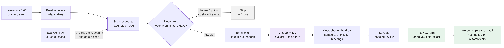
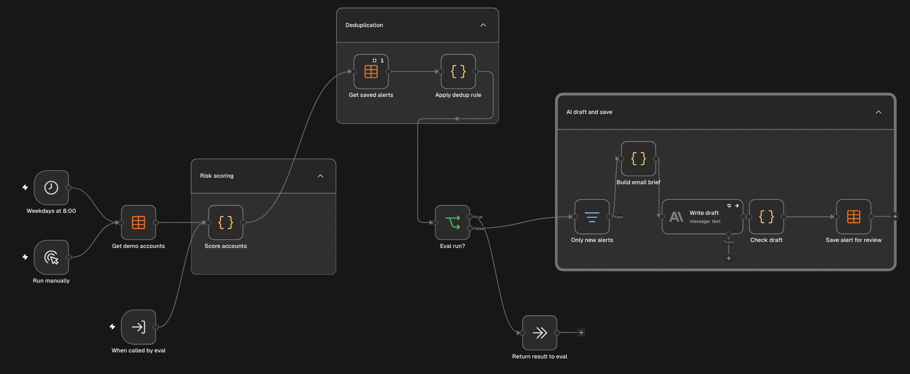

# Churn Risk Alert: daily account alerts with human review in n8n

A portfolio project using fictional customer accounts. Every weekday it flags accounts that may be at risk of leaving, writes a short follow-up email draft and waits for a person to approve it. It does not contact customers.

## Problem

Customer Success teams often notice a struggling account too late: usage drops, tickets pile up and nobody has talked to the customer in weeks. A weekly report helps, but it does not react on the day a threshold is crossed. A daily alert has the opposite risk: it repeats the same warning every morning until people stop reading it.

## What it does

1. Runs every weekday at 8:00 (Europe/Warsaw) or on demand.
2. Reads account data from an n8n data table.
3. Scores each account with fixed rules in code and saves the reason for every point.
4. Creates an alert from 6 points, unless the account already has an open alert from the last 7 days.
5. Picks one email topic with code: renewal, open tickets, team adoption, product fit or a quiet period.
6. Asks Claude to write only the subject and body for that topic, without the account name or metrics.
7. Checks the draft with code and adds the real account name back.
8. Saves the alert as `pending review` with the reasons and an internal note.
9. A login-protected n8n form shows pending alerts. A person sets `approved`, `edit` or `rejected` with a note.

## Scoring rules

All thresholds sit in one `RULES` block at the top of the `Score accounts` node.

| Signal | Points |
| --- | --- |
| Usage down 15% or more in 30 days | 2 |
| Usage down 30% or more in 30 days | 3 |
| Fewer than 30% of users active | 2 |
| 3 or more open tickets | 2 |
| No contact for more than 30 days | 1 |
| No contact for more than 45 days | 2 |
| Renewal within 60 days | 2 |
| Renewal within 30 days | 3 |

An empty value is reported as missing data, not counted as zero. A renewal date in the past gives no points.

## Key design decisions

- **No AI in the decision:** whether an account gets an alert depends only on code, so the same data always gives the same result and every point can be explained.
- **Deduplication:** an account is skipped while it has a `pending review` or `approved` alert from the last 7 days. It gets a new alert only if its score rises by 2 points or more. `edit` and `rejected` do not block.
- **Failed drafts retry:** if the AI call fails, the alert is saved with `NO DRAFT` so a person still sees it, but it does not block the account the next day.
- **AI writes words, not decisions:** code chooses the topic and the one fact the email may mention. The model never sees the account name, revenue, metrics or internal notes.
- **Code checks after AI:** the draft is flagged if it contains a number that is not in the brief, a promise, free work or a discount, a meeting request, monitoring language such as "usage" or "flagged", generic phrases such as "reaching out", or a missing sign-off.
- **Human review:** `approved` only means ready to copy. Nothing is sent from any mailbox.
- **Separate evaluation:** a second workflow runs test accounts through the same scoring and deduplication code without calling the AI or writing alerts.

## Test results

| Test | Result |
| --- | --- |
| 38 edge cases, alert decision | 38 of 38 |
| 38 edge cases, score | 38 of 38 |
| Two runs in a row on the demo data | 4 alerts, then 0 new alerts |
| Scheduled run with all alerts still open | finished in 2 seconds with no AI calls |
| Code checks on the latest 4 drafts | 0 flags |

The test cases cover values just below and just above every threshold, the 7-day window, score rises of 1 and 2 points, every review status and a failed draft. See `test-results.md`.

These are small tests on fictional data, and I set the expected answers myself. They show that the rules behave as designed, not that they predict which customers will leave.

## Tools

- n8n, n8n Data Tables and n8n Forms
- JavaScript in n8n Code nodes
- Anthropic Claude Haiku
- Claude for AI-assisted building, review and testing

## My role

I built this project with AI assistance. I defined the scoring rules, the deduplication rule, the review process and the email rules, set the expected answers for every test case, reviewed the drafts and chose the improvements.

## What broke and what I changed

- **Cut-off answers:** the model used part of its token limit for reasoning, so 3 of 4 drafts in the first run were invalid JSON. I raised the limit and kept the JSON check.
- **Meeting requests:** early drafts asked for a call. I added a rule to the prompt and a separate code check.
- **Drafts that sounded like monitoring:** emails quoted usage drops back to the customer and opened with "I wanted to reach out". Code now picks one topic and one allowed fact, and the email has to end with a question the customer can answer in one line.
- **Internal notes in customer emails:** one draft congratulated a customer on a new hire it only knew from an internal note. Notes no longer go to the model at all.
- **Failed drafts blocked accounts:** an alert without a draft blocked the account for 7 days. It now gets a new attempt the next day, with its own test case.
- **Open review form:** anyone with the link could change statuses. The form now requires an n8n login.

## Data and privacy

The account data is read from a data table that acts as a contract between the data source and the workflow. In a real setup a separate sync workflow would fill it from a CRM, helpdesk and product analytics through their APIs, or through an authenticated webhook. See `data-and-privacy.md` for the field list, both integration options and the data protection notes.

## Limits

- All accounts are fictional. The thresholds are a reasonable starting point, not tuned on real churn data.
- If the data sync fails, the workflow would score yesterday's data. A real deployment needs a failure alert and a freshness check.
- The code checks catch risky wording, but a person still has to judge whether the email makes sense for that customer.
- Alerts and n8n execution history keep data, so a real deployment needs retention settings and access rules.

## Files

- `Churn Risk Alert.json`: main n8n workflow export
- `Churn Alert Review.json`: review form workflow export
- `Churn Risk Alert Eval.json`: evaluation workflow export
- `demo_accounts.csv`: 28 fictional accounts, including edge cases just below and above the threshold
- `eval_cases.csv`: 38 test cases with expected scores and alert decisions
- `sample-results.md`: example drafts before and after the changes
- `test-results.md`: test method and results
- `data-and-privacy.md`: data contract, integration options and data protection notes
- `workflow-diagram.png`: workflow overview
- `workflow.png`: n8n workflow screenshot

## How to import

1. Create three n8n data tables: `Demo Accounts`, `Churn Alerts` and `Churn Eval Cases` (plus `Churn Eval Runs` for test results), and import the CSV files.
2. Import the three workflow JSON files.
3. Select your own data tables in the data table nodes and an Anthropic credential in `Write draft`.
4. In `Churn Risk Alert Eval`, select `Churn Risk Alert` in the `Run scoring and dedup` node.

## Next improvements

- Add the data sync workflow with a CRM and helpdesk API.
- Add an error workflow that alerts a person when a run fails.
- Delete alerts older than 90 days automatically.
- Test the email drafts with a larger set of fictional accounts.

## Screenshots

